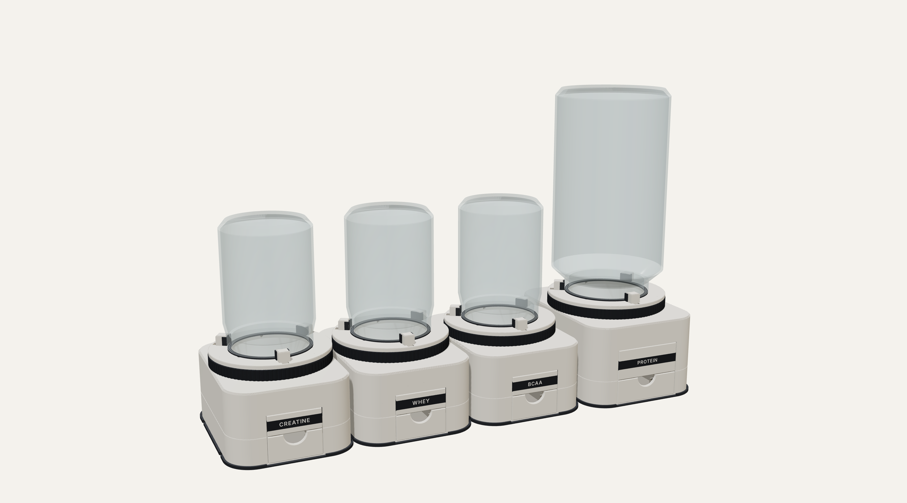
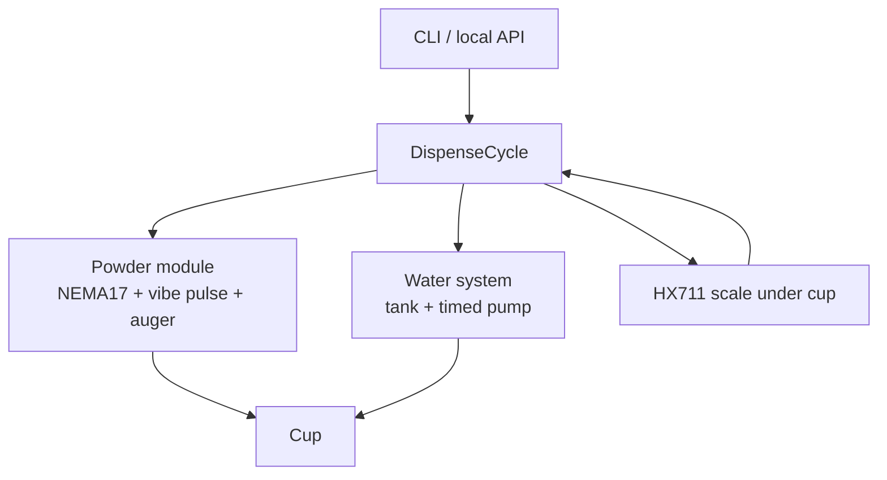
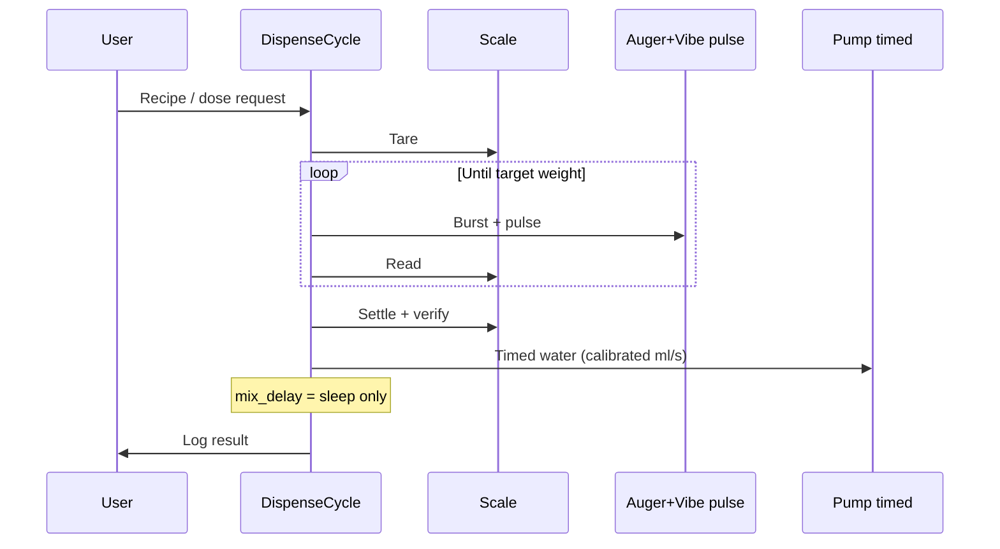

# DIY Supplement Dispenser

> **Current design: Dose Bar v6** — a fully manual, 3D-printed dispenser for your own jars (PLA + TPU, no electronics).
> One pull of the scoop drawer gives one measured dose. Start here: **[docs/v6/README.md](docs/v6/README.md)** ·
> [Print guide](docs/v6/PRINT_GUIDE.md) · [Assembly](docs/v6/ASSEMBLY.md) · [Use and calibrate](docs/v6/USE_AND_CALIBRATE.md) ·
> [Handoff](docs/v6/HANDOFF.md) · STLs in [`stl/v6/`](stl/v6/)
>
> 
>
> Everything below this box describes the earlier electronic concept (v0.2) and is kept for reference.

**DIY home machine for dosing supplement powders into a cup** — closed-loop load cell for powder, **open-loop timed water** from a refillable tank, then a short settle delay. Built as a **hybrid project**: buy electronics / pumps / motors; **3D-print** hoppers, frames, and mounts.

Phase 1 is a **bench prototype**, not a polished vending appliance. Simulation works today; first physical builds need current **v0.2** print geometry and calibrated hardware. A drink in the cup is a **goal after calibration and testing**, not a guaranteed out-of-box product claim.

| Status | Phase 1 software + docs foundation; physical bring-up pending prints |
|--------|------------------------------|
| License | MIT |
| Controller | Raspberry Pi 5 (Pi 4 compatible) |
| Repo | [mlwhite0907/DIY-Supplement-Dispenser](https://github.com/mlwhite0907/DIY-Supplement-Dispenser) |

---

## What it does (Phase 1 honesty)

1. Run a recipe from **CLI** or **local FastAPI** (localhost-oriented)  
2. **Closed-loop weighing** doses powder toward target (**±0.1 g goal** after settle)  
3. **Water** is pumped on a **calibrated timer** (verify with graduated cylinder; flow pin reserved for later)  
4. **`mix_delay`** is a **sleep only** — no mixer motor in Phase 1  
5. Log results in SQLite  

Later phases: multi-station, pills, touchscreen, up to **~12** modular stations.

---

## Repository map

```
├── README.md                 ← you are here
├── docs/                     ← plans, BOM, assembly, architecture, tests
│   ├── BOM.md                ← quantities & cost ranges
│   ├── BOM_AMAZON.md         ← Amazon search keywords + ASINs
│   ├── SHOPPING_CHECKLIST.md ← printable checkboxes
│   ├── PROJECT_PLAN.md       ← phases, exit criteria, schedule
│   ├── SYSTEM_ARCHITECTURE.md
│   ├── SOFTWARE_ARCHITECTURE.md
│   ├── ASSEMBLY_GUIDE.md     ← bench → first drink
│   ├── TESTING_PROTOCOL.md
│   ├── SAFETY_AND_HYGIENE.md
│   ├── PHASE1_DESIGN_HANDOFF.md  ← locked CAD dimensions (~450+ ml hopper, v0.2 stack-up)
│   ├── images/               ← photos TBD
│   └── diagrams/             ← Mermaid sources (.mmd)
├── hardware/                 ← electrical design
│   ├── PINOUT.md             ← BCM GPIO map (locked for Phase 1)
│   ├── WIRING.md
│   ├── ELECTRICAL_SCHEMATIC.md
│   ├── POWER_BUDGET.md
│   └── modules/              ← powder, water, scale notes
├── software/                 ← Python Phase 1 stack (sim + Pi)
│   ├── src/dispenser/        ← control, hardware drivers, FastAPI, CLI
│   ├── tests/                ← hardware-free pytest
│   └── config/default.yaml
└── 3d_models/                ← OpenSCAD + printable STLs
    ├── openscad/             ← parametric sources (v0.2 stack-up in constants)
    ├── stl/                  ← exports for Bambu Studio
    └── PRINT_GUIDE.md
```

---

## Quick start (no hardware)

Develop and demo the control stack in **simulation mode** on any Mac/Linux machine:

```bash
cd software
python3 -m venv .venv && source .venv/bin/activate
pip install -e ".[dev]"
export DISPENSER_SIM=1

pytest -q
python -m dispenser dose-powder --grams 3
python -m dispenser dose-water --ml 200
python -m dispenser run-recipe creatine_water
python -m dispenser serve --port 8000
# open http://127.0.0.1:8000/docs for the OpenAPI UI (local use)
```

On a Raspberry Pi, set `hardware.mode: pi` in `software/config/default.yaml` (or `DISPENSER_SIM=0`) and install Pi GPIO / HX711 libraries — see [software/README.md](software/README.md).

API is intended for **localhost / bench** use; optional auth token when exposing beyond loopback — see [docs/SOFTWARE_ARCHITECTURE.md](docs/SOFTWARE_ARCHITECTURE.md).

---

## Phase 1 goal (start here)

Prove **one powder station + timed water + settle delay** on a bench before building a multi-station cabinet.

| Subsystem | Approach |
|-----------|----------|
| Powder | Steep conical hopper (~**450+ ml**) → 3D-printed auger → NEMA17 + TMC2209 → **pulse** vibration assist |
| Accuracy | HX711 + 5 kg load cell under the cup (closed-loop powder; **±0.1 g goal**) |
| Water | Refillable 2–5 L tank + 12 V pump; **open-loop timed** after `ml_per_second` cal |
| Control | Raspberry Pi, YAML config, CLI + local FastAPI |
| Mechanics | PETG prints — **v0.2 stack-up** (closed free end; insert auger from free end) |

**Success criteria:** powder within **±0.1 g** after settle (goal); water within **±5–10 ml** after open-loop calibration. Protocol: [docs/TESTING_PROTOCOL.md](docs/TESTING_PROTOCOL.md).

---

## Buy the parts (Amazon-oriented)

1. Read the costed BOM: **[docs/BOM.md](docs/BOM.md)**  
2. Shop with keywords / example ASINs: **[docs/BOM_AMAZON.md](docs/BOM_AMAZON.md)**  
3. Print checkboxes: **[docs/SHOPPING_CHECKLIST.md](docs/SHOPPING_CHECKLIST.md)**  

| Cart | Approx. USD (parts only) |
|------|---------------------------|
| Phase 1 MVP | **$250–500** |
| Full Phase 1 (touch + sensors) | **$350–750** |
| Each extra powder station later | **+$25–50** electronics |

Prices fluctuate — verify on Amazon. Prefer **food-grade** wet-path parts.

---

## Wire it (Phase 1 GPIO map)

Full tables, colors, and schematics live under [`hardware/`](hardware/). Locked BCM map:

| Function | GPIO (BCM) |
|----------|------------|
| HX711 DT / SCK | **5** / **6** |
| Stepper STEP / DIR / EN | **12** / **13** / **16** |
| Vibration MOSFET | **17** |
| Pump MOSFET | **27** |
| Flow (reserved) / Level / Cup / E-stop | **22** / **23** / **24** / **25** |

**Rules of thumb:** dual PSU (official Pi USB-C + separate fused **12 V** for motors/pump); common ground; **never** drive motors from Pi pins; MOSFET low-side switching with flyback protection.

- [hardware/PINOUT.md](hardware/PINOUT.md)  
- [hardware/WIRING.md](hardware/WIRING.md)  
- [hardware/ELECTRICAL_SCHEMATIC.md](hardware/ELECTRICAL_SCHEMATIC.md)  
- [hardware/POWER_BUDGET.md](hardware/POWER_BUDGET.md)  
- [docs/ASSEMBLY_GUIDE.md](docs/ASSEMBLY_GUIDE.md)  

---

## Print the mechanics

Parametric OpenSCAD sources + STLs. **First physical print should use v0.2 stack-up** (coupler zone, closed free end, shorter flights) — see [docs/PHASE1_DESIGN_HANDOFF.md](docs/PHASE1_DESIGN_HANDOFF.md) §4.6 and `3d_models/openscad/lib/constants.scad`.

| Part | File (names may keep `_v01` for path stability) |
|------|------|
| Powder hopper (65° cone, Ø90→22, ~450+ ml) | `3d_models/stl/powder_hopper_v01.stl` |
| Auger screw | `3d_models/stl/auger_screw_v01.stl` |
| Auger housing + NEMA17 + vibe pocket | `3d_models/stl/auger_housing_v01.stl` |
| Test stand | `3d_models/stl/test_stand_v01.stl` |
| Scale platform (5 kg bar cell) | `3d_models/stl/scale_platform_v01.stl` |

Material: **PETG**. Settings and orientations: [3d_models/PRINT_GUIDE.md](3d_models/PRINT_GUIDE.md).  
Hopper print note: point-down beds the **outlet rim**; interior is still **layered walls** — slow outer walls for finish.

```bash
cd 3d_models && make stl    # re-export if OpenSCAD CLI is installed
```

**Assembly:** insert auger from the **free end** (not through the motor plate).

---

## Assemble & test

1. [docs/ASSEMBLY_GUIDE.md](docs/ASSEMBLY_GUIDE.md) — unbox → wire → dry-run → first drink  
2. [docs/TESTING_PROTOCOL.md](docs/TESTING_PROTOCOL.md) — calibration + 20× powder trials + open-loop water  
3. [docs/SAFETY_AND_HYGIENE.md](docs/SAFETY_AND_HYGIENE.md) — food-contact, cleaning, electrical isolation  

**Not a medical device.** For personal convenience dosing of dietary supplements only. Clean wet parts regularly.

---

## System overview



Dispense sequence (simplified):



More diagrams: [`docs/diagrams/`](docs/diagrams/) and [docs/SYSTEM_ARCHITECTURE.md](docs/SYSTEM_ARCHITECTURE.md).

---

## Roadmap

| Phase | Focus | Exit when… |
|-------|--------|------------|
| **1** | Single powder + timed water + settle | ±0.1 g goal / ±5–10 ml proven on real powder |
| **2** | Multi-module + pills + shared frame | 3+ stations reliable |
| **3** | Full multi-station UI + inventory + WiFi | Daily-driver UX |
| **4** | Jam recovery, long-run reliability, polish | Weeks of stable use |

Details and weekly schedule: [docs/PROJECT_PLAN.md](docs/PROJECT_PLAN.md).

---

## Software stack (Phase 1)

- **Python 3.11+** package `dispenser`
- Hardware abstractions + **sim backends** (Mac-friendly) — **sim works**
- Closed-loop **powder** dosing with jam reverse-auger; vibe **pulses**
- **Timed water** only (`WaterDoser`); flow pin reserved future
- **`mix_delay`** sleep — no mixer motor
- **`DispenseCycle`** linear script + cup / interlocks — not a full FSM
- **SQLite** recipes / inventory / logs
- **FastAPI** REST + **CLI**; localhost-oriented API, optional token for LAN
- Config: `software/config/default.yaml` (GPIO map matches hardware docs)

See [software/README.md](software/README.md) and [docs/SOFTWARE_ARCHITECTURE.md](docs/SOFTWARE_ARCHITECTURE.md).

---

## Contributing / iterating

1. Prefer risk-first: improve Phase 1 dosing before expanding station count.  
2. Keep the **GPIO map** and **hopper geometry locks** (65°, 90→22) stable unless you bump a version.  
3. Run `pytest` under `software/` with `DISPENSER_SIM=1` before committing software changes.  
4. Re-export STLs after OpenSCAD edits (`3d_models/make stl`).  
5. Docs under `docs/` should match real behavior — do not invent closed-loop water or mixer motors.

---

## License

MIT — see [LICENSE](LICENSE).

Built for practical home DIY. Iterate from real powder behavior, not only CAD.
