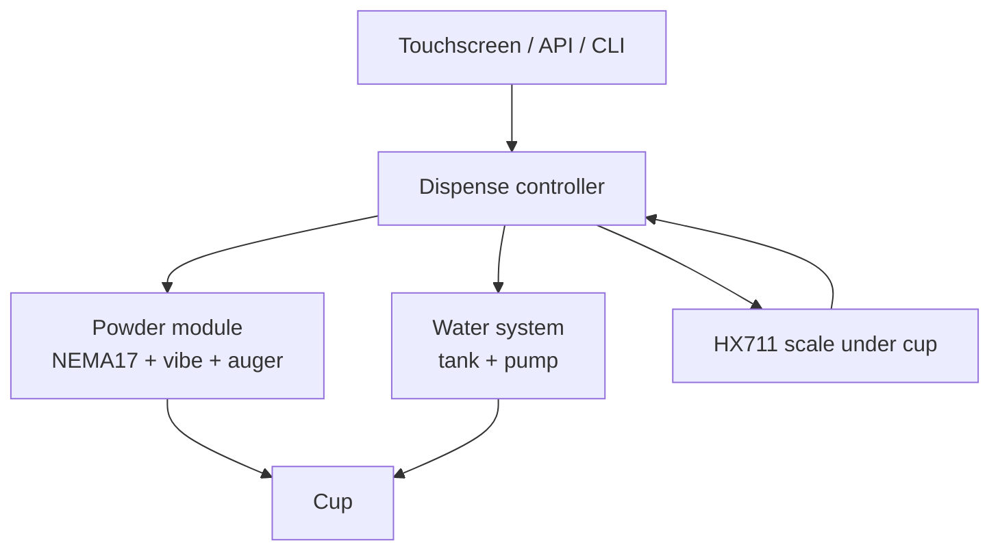
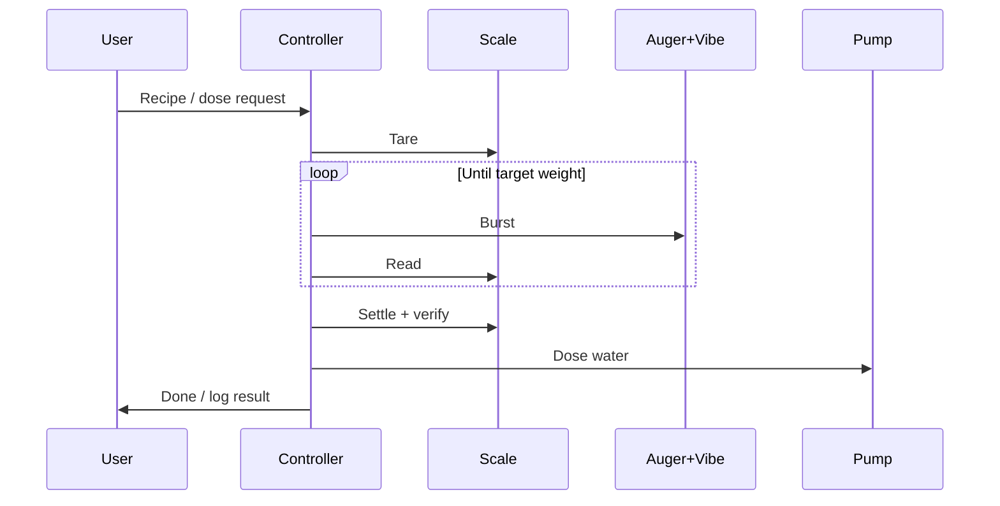

# DIY Supplement Dispenser

**Smart home vending machine for supplement drinks** — pick powders (and later pills) on a touchscreen, dose by closed-loop load cell, add water from a refillable tank, mix, and pour a ready-to-drink cup.

Looks and feels like a modern beverage machine. Built as a **hybrid project**: buy electronics / pumps / motors; **3D-print** hoppers, frames, and mounts.

| Status | Phase 1 foundation complete |
|--------|------------------------------|
| License | MIT |
| Controller | Raspberry Pi 5 (Pi 4 compatible) |
| Repo | [mlwhite0907/DIY-Supplement-Dispenser](https://github.com/mlwhite0907/DIY-Supplement-Dispenser) |

---

## What it does

1. Select a recipe (or individual supplements) on the UI  
2. Machine activates the right powder (and later pill) modules  
3. **Closed-loop weighing** doses each powder to target (±0.1 g goal)  
4. **Water** is pumped from a refillable tank (no hard plumbing)  
5. Optional mix → ready drink in the cup  

**Capacity target:** up to **12** modular stations.

---

## Repository map

```
├── README.md                 ← you are here
├── docs/                     ← plans, BOM, assembly, architecture, tests
│   ├── BOM.md                ← quantities & cost ranges
│   ├── BOM_AMAZON.md         ← Amazon search keywords + ASINs
│   ├── SHOPPING_CHECKLIST.md ← printable checkboxes
│   ├── PROJECT_PLAN.md       ← phases, exit criteria, schedule
│   ├── SYSTEM_ARCHITECTURE.md
│   ├── SOFTWARE_ARCHITECTURE.md
│   ├── ASSEMBLY_GUIDE.md     ← bench → first full drink
│   ├── TESTING_PROTOCOL.md
│   ├── SAFETY_AND_HYGIENE.md
│   ├── PHASE1_DESIGN_HANDOFF.md  ← locked CAD dimensions
│   └── diagrams/             ← Mermaid sources (.mmd)
├── hardware/                 ← electrical design
│   ├── PINOUT.md             ← BCM GPIO map (locked for Phase 1)
│   ├── WIRING.md
│   ├── ELECTRICAL_SCHEMATIC.md
│   ├── POWER_BUDGET.md
│   └── modules/              ← powder, water, scale notes
├── software/                 ← Python Phase 1 stack (sim + Pi)
│   ├── src/dispenser/        ← control, hardware drivers, FastAPI, CLI
│   ├── tests/                ← 23 tests, hardware-free
│   └── config/default.yaml
└── 3d_models/                ← OpenSCAD + printable STLs
    ├── openscad/             ← parametric sources
    ├── stl/                  ← v01 exports for Bambu Studio
    └── PRINT_GUIDE.md
```

---

## Quick start (no hardware)

Develop and demo the control stack in **simulation mode** on any Mac/Linux machine:

```bash
cd software
python3 -m venv .venv && source .venv/bin/activate
pip install -e ".[dev]"
export DISPENSER_SIM=1

pytest -q                          # 23 tests
python -m dispenser dose-powder --grams 3
python -m dispenser dose-water --ml 200
python -m dispenser run-recipe creatine_water
python -m dispenser serve --port 8000
# open http://127.0.0.1:8000/docs for the OpenAPI UI
```

On a Raspberry Pi, set `hardware.mode: pi` in `software/config/default.yaml` (or `DISPENSER_SIM=0`) and install Pi GPIO / HX711 libraries — see [software/README.md](software/README.md).

---

## Phase 1 goal (start here)

Prove **one powder station + water + mix** makes consistent, accurately dosed drinks before building a 12-station cabinet.

| Subsystem | Approach |
|-----------|----------|
| Powder | Steep conical hopper → 3D-printed auger → NEMA17 + TMC2209 → vibration assist |
| Accuracy | HX711 + 5 kg load cell under the cup (closed-loop) |
| Water | Refillable 2–5 L tank + 12 V food-grade peristaltic pump |
| Control | Raspberry Pi, YAML config, FastAPI + CLI |
| Mechanics | PETG prints — see OpenSCAD / STL set |

**Success criteria:** powder within **±0.1 g** after settle; water within **±5–10 ml**. Full protocol: [docs/TESTING_PROTOCOL.md](docs/TESTING_PROTOCOL.md).

---

## Buy the parts (Amazon-oriented)

1. Read the costed BOM: **[docs/BOM.md](docs/BOM.md)**  
2. Shop with keywords / example ASINs: **[docs/BOM_AMAZON.md](docs/BOM_AMAZON.md)**  
3. Print checkboxes: **[docs/SHOPPING_CHECKLIST.md](docs/SHOPPING_CHECKLIST.md)**  

| Cart | Approx. USD (parts only) |
|------|---------------------------|
| Phase 1 MVP | **$250–500** |
| Full Phase 1 (touch + sensors) | **$350–750** |
| Each extra powder station later | **+$25–50** electronics |

Prices fluctuate — verify on Amazon. Prefer **food-grade** wet-path parts.

---

## Wire it (Phase 1 GPIO map)

Full tables, colors, and schematics live under [`hardware/`](hardware/). Locked BCM map:

| Function | GPIO (BCM) |
|----------|------------|
| HX711 DT / SCK | 5 / 6 |
| Stepper STEP / DIR / EN | 12 / 13 / 16 |
| Vibration MOSFET | 17 |
| Pump MOSFET | 27 |
| Flow / Level / Cup / E-stop | 22 / 23 / 24 / 25 |

**Rules of thumb:** dual PSU (official Pi 27W USB-C + separate fused **12 V** for motors/pump); common ground; **never** drive motors from Pi pins; MOSFET low-side switching with flyback protection.

- [hardware/PINOUT.md](hardware/PINOUT.md)  
- [hardware/WIRING.md](hardware/WIRING.md)  
- [hardware/ELECTRICAL_SCHEMATIC.md](hardware/ELECTRICAL_SCHEMATIC.md)  
- [hardware/POWER_BUDGET.md](hardware/POWER_BUDGET.md)  

---

## Print the mechanics

Parametric OpenSCAD sources + pre-exported STLs for **v0.1**:

| Part | File |
|------|------|
| Powder hopper (65° cone, Ø90→22) | `3d_models/stl/powder_hopper_v01.stl` |
| Auger screw | `3d_models/stl/auger_screw_v01.stl` |
| Auger housing + NEMA17 + vibe pocket | `3d_models/stl/auger_housing_v01.stl` |
| Test stand | `3d_models/stl/test_stand_v01.stl` |
| Scale platform (5 kg bar cell) | `3d_models/stl/scale_platform_v01.stl` |

Material: **PETG**. Settings and orientations: [3d_models/PRINT_GUIDE.md](3d_models/PRINT_GUIDE.md).  
Locked dimensions: [docs/PHASE1_DESIGN_HANDOFF.md](docs/PHASE1_DESIGN_HANDOFF.md).

```bash
cd 3d_models && make stl    # re-export if OpenSCAD CLI is installed
```

---

## Assemble & test

1. [docs/ASSEMBLY_GUIDE.md](docs/ASSEMBLY_GUIDE.md) — unbox → wire → dry-run → first drink  
2. [docs/TESTING_PROTOCOL.md](docs/TESTING_PROTOCOL.md) — calibration + 20× dose trials  
3. [docs/SAFETY_AND_HYGIENE.md](docs/SAFETY_AND_HYGIENE.md) — food-contact, cleaning, electrical isolation  

**Not a medical device.** For personal convenience dosing of dietary supplements only. Clean wet parts regularly.

---

## System overview



Dispense sequence (simplified):



More diagrams: [`docs/diagrams/`](docs/diagrams/) and [docs/SYSTEM_ARCHITECTURE.md](docs/SYSTEM_ARCHITECTURE.md).

---

## Roadmap

| Phase | Focus | Exit when… |
|-------|--------|------------|
| **1** | Single powder + water + mix | ±0.1 g / ±5–10 ml proven on real powder |
| **2** | Multi-module + pills + shared frame | 3+ stations reliable |
| **3** | Full 12-station vending UI + inventory + WiFi | Daily-driver UX |
| **4** | Jam recovery, long-run reliability, polish | Weeks of stable use |

Details and weekly schedule: [docs/PROJECT_PLAN.md](docs/PROJECT_PLAN.md).

---

## Software stack (Phase 1)

- **Python 3.11+** package `dispenser`
- Hardware abstractions + **sim backends** (Mac-friendly)
- Closed-loop **powder dosing** with jam reverse-auger
- Timed **water** dosing (flow sensor ready)
- **SQLite** recipes / inventory / logs
- **FastAPI** REST API + **CLI**
- Config: `software/config/default.yaml` (GPIO map matches hardware docs)

See [software/README.md](software/README.md) and [docs/SOFTWARE_ARCHITECTURE.md](docs/SOFTWARE_ARCHITECTURE.md).

---

## Contributing / iterating

1. Prefer risk-first: improve Phase 1 dosing before expanding station count.  
2. Keep the **GPIO map** and **hopper geometry** stable unless you bump a version (`_v02`).  
3. Run `pytest` under `software/` with `DISPENSER_SIM=1` before committing software changes.  
4. Re-export STLs after OpenSCAD edits (`3d_models/make stl`).

---

## License

MIT — see [LICENSE](LICENSE).

Built for practical home DIY. Iterate from real powder behavior, not only CAD.
