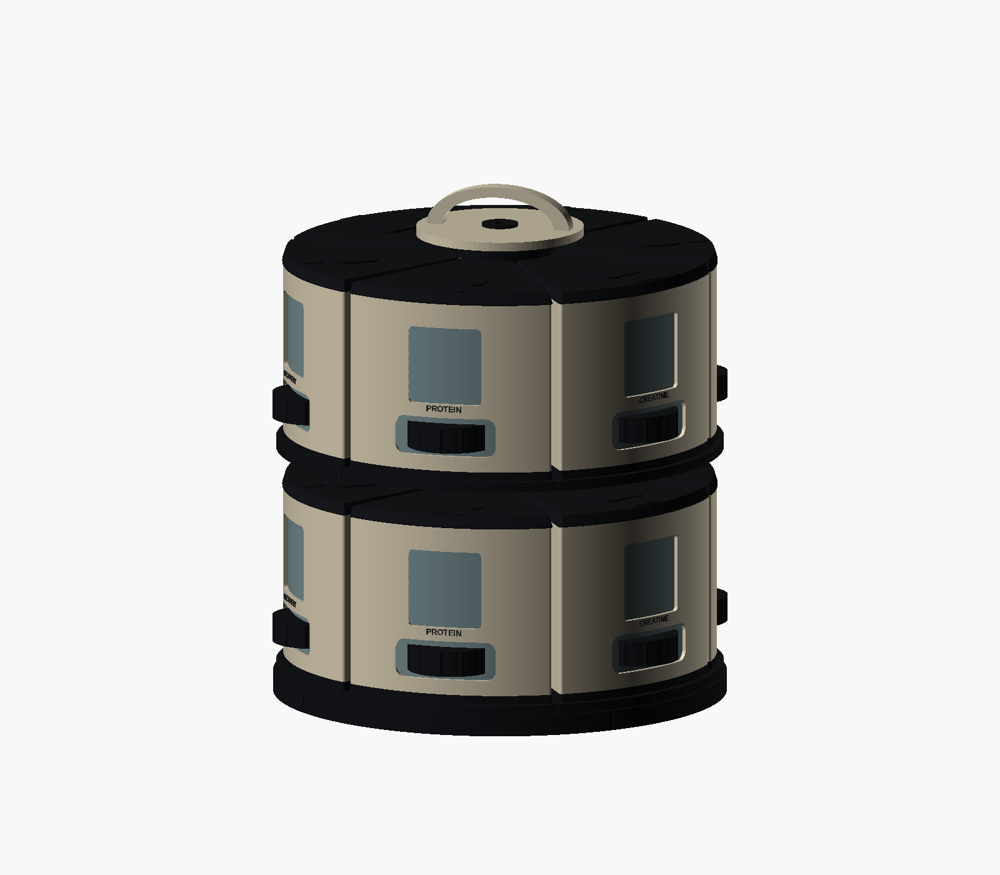

# Countertop powder carousel

**Current design: twelve cartridges, six per tier.** The new exterior follows the reference video: satin/champagne wedge fronts, black caps and rims, rectangular windows, individual ridged thumbwheels and a carry-handle shape. Two complete circles can be separated into individual tiers.

This is a **visual CAD prototype**, ready for appearance review. The internal dispensing system, working retention latches, bearings, detachable structural joint and overhead mounting are not yet validated. Nothing has been physically printed or tested.

- [Current model, views, dimensions and reproduction instructions](prototype-v01/README.md)
- [Colored 3D model (GLB)](prototype-v01/exports/carousel-12.glb)
- [Editable OpenSCAD source](prototype-v01/cad/appearance.scad)
- [Separated tiers](prototype-v01/images/separated-tiers.png) and [cartridge close-up](prototype-v01/images/cartridge.png)
- [Handoff for the next session or agent](HANDOFF.md)
- [Worklog](WORKLOG.md)
- [Original Instagram reel](https://www.instagram.com/reel/DfjxlAlBuUp/?hvrq=aXpzbjd5bXNxbXhh) and [captured reference frame](prototype-v01/images/reference-instagram.png)

The original five-per-tier proposal is retained in [the initial study](archive/initial-study.md). It is superseded. The later idea of 24 cartridges was explicitly rejected; six plus six is the current arrangement.

All changes stay in this folder on `codex/carousel-concept`. Claude's existing implementation and the repository's main dispenser files are unchanged.
