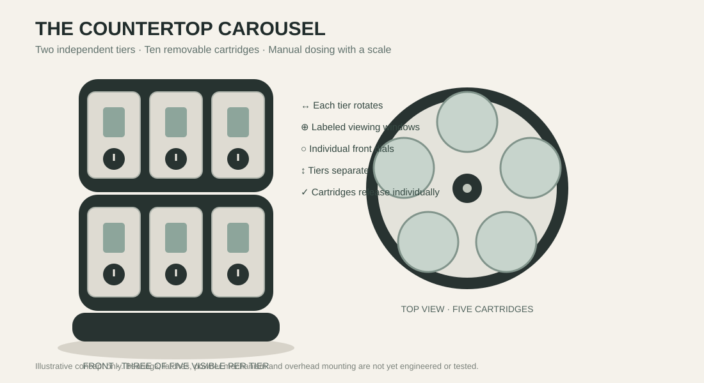

# Countertop supplement carousel

> **Current design: [12-cartridge V01 model and previews](../prototype-v01/README.md), six per tier.** See [HANDOFF.md](../HANDOFF.md) for Michael's latest requirements and continuation instructions. The five-per-tier text and drawing below are preserved as the initial study, superseded on November 27, 2026. The current visual model is not yet a validated mechanical dispenser.

**Independent Codex concept, 27 November 2026.** A two-tier, manually rotating carousel with ten removable, individually dialed powder cartridges. Each five-cartridge tier can be separated and used on its own; a separate under-cabinet mount is a design goal. This is an early design study, not a print-ready dispenser or a change to the current Phase 1 design.

## Reference and inspiration

- [Instagram reel: rotating spice carousel](https://www.instagram.com/reel/DfjxlAlBuUp/?hvrq=aXpzbjd5bXNxbXhh), posted by **@rgstore369**, dated November 10, 2026; viewed November 27, 2026.
- The page's Portuguese caption says “Prateleira Porta Temperos De Parede Alumínio Sem Furo 2 Andares Com Colheres” (roughly, a no-drill two-tier aluminum wall spice rack with spoons). That caption alone does not establish the maker, product specifications, or the mechanism of the carousel shown.
- In the visible video, a black circular rack hangs below a cabinet, rotates around a central support, and presents a ring of individually labeled, light metallic-looking containers with windows and dark controls near their lower front. A container is removed and handled separately. The compact carousel, contrasting top and bottom rings, clean faces, windows, and individual controls give it the appliance-like look we want. The exact latch, internal mechanism, capacity, material, and dosing accuracy are not established by the frames viewed. The page labels the posting profile as AI-generated; that does not establish whether the product or video is generated.
- Michael's reading of the reference and desired experience: click and pull out a cartridge, turn its spindle to dispense, click it back into the carousel; two five-cartridge levels that can come apart, including an under-cabinet option. Treat the tier separation and exact portion mechanism as design requirements for this concept, not verified facts about the video.

## The proposed product

1. **Two independent rotating tiers**, each holding five cartridges at 72° intervals. A broad, weighted countertop base supports the stack. Turn either tier by hand to bring the desired cartridge to the front.
2. **Ten individually removable cartridges.** A visible release tab and guided cradle should allow a cartridge to come straight out without releasing its neighbors. The cartridge needs a positive, tactile latch and an independent closed position before removal. A dust cap or self-closing outlet prevents spills in transit.
3. **A dial on every cartridge.** The first mechanism to prototype is a hand-turned metering rotor or short auger, with an off position and detents. The user holds the cartridge over a cup on a small digital scale and turns the dial in coarse, then small increments. This preserves the appealing individual controls and keeps every powder path separate.
4. **Split and reconfigure.** Each complete tier gets its own bearing and structural hub. A mechanically locked, keyed connector joins the tiers; the upper tier can be removed while its five cartridges remain secured. One tier could instead attach to a purpose-built under-cabinet bracket with a positive mechanical lock and independent retention. Do not rely on magnets or adhesive alone for a loaded overhead unit. A safe bracket, cabinet substrate, fasteners, and weight rating must be engineered and tested first.
5. **Countertop appearance.** Smooth circular top, slim separators, a quiet matte warm-white or charcoal body, brushed-metal-look fronts, legible removable labels, and clear windows. Hide the bearing and fasteners. Use a stable, wipeable base with non-slip feet. The drawing is a visual direction, not a claim that any particular materials are food safe.

## Sizing study, not locked dimensions

| Item | Starting envelope | What this means |
|---|---:|---|
| Cartridges | 5 per tier, 10 total | 72° spacing; independent rotation |
| Cartridge location | 105 mm radius from center | Centers of neighbors are about 123 mm apart |
| Cartridge envelope | 100 mm diameter × 150 mm tall | Placeholder cylinder; latches, dial, outlet and clearance must fit inside or expand the envelope |
| Clear cylindrical storage | 90 mm inside diameter × 110 mm | About 700 mL **geometric maximum** before mechanism, headspace and tapered floor; usable volume and powder mass unverified |
| Tier outside diameter | approximately 320 mm | 105 mm center radius + 50 mm cartridge radius + 5 mm radial clearance, on each side |
| Two-tier overall height | approximately 400 mm | Rough visual envelope including base, two tiers and top; actual mechanical design may be taller |

Protein powder often takes much more space than spices. Ten equal cartridges are a starting point, not a promise that ten full commercial tubs will fit. An alternative is two larger protein cartridges and eight smaller supplement cartridges, while retaining five positions per tier. Confirm actual powder weights, desired refill interval, cabinet clearance, cup size and counter space before locking dimensions.

## Dosing and safety decisions

- **A click measures a volume or a turn, not a verified mass.** Powder density, humidity, settling, flow and a partly empty container change grams per click. Do not label detents as exact grams without powder-specific testing. Read the cup scale after settling, and stop or correct by hand. Targets are goals, not proven precision. Concentrated ingredients may require a separate appropriate scale; this concept is not a medication dispenser.
- **Keep each product isolated.** No shared powder chute is needed in this manual version. Clearly label cartridges and keep allergens separated. Design the removable metering assembly so it can be opened and cleaned completely, then fully dried before refill.
- Prefer suitable, traceable food-contact liners, seals and components. Printed parts and filament alone do not establish food-contact suitability; layer lines, wear particles, retained powder, inaccessible crevices and cleaning are unresolved. Do not use the visual mockup for food or overhead mounting.
- This concept does not yet implement the existing motorized scale-control software, water system or safety interlocks. An automated dock and shared scale are possible future alternatives, but must be engineered separately without assuming the existing code or hardware already supports them.

## Files and next steps

- [Concept layout](../concept-layout.svg): visual arrangement and approximate scale.
- [Parametric layout model](../carousel-layout.scad): simplified, editable OpenSCAD massing model; not functional hardware and not a printable assembly.
- [Development and test plan](../development-plan.md): mechanisms, interfaces, decisions and validation sequence.

First build **one** cartridge and its dial/closure test rig with representative powders. Check whether it actually flows, closes, cleans, and gives controllable small increments on a verified scale. Then prototype a five-position tier, its retention and independent bearing, followed by the tier connector and stable base. Only after those pass should the ten-cartridge assembly or overhead mount be treated as a practical design. No physical prototype, fit, scale accuracy or load test has been performed.
