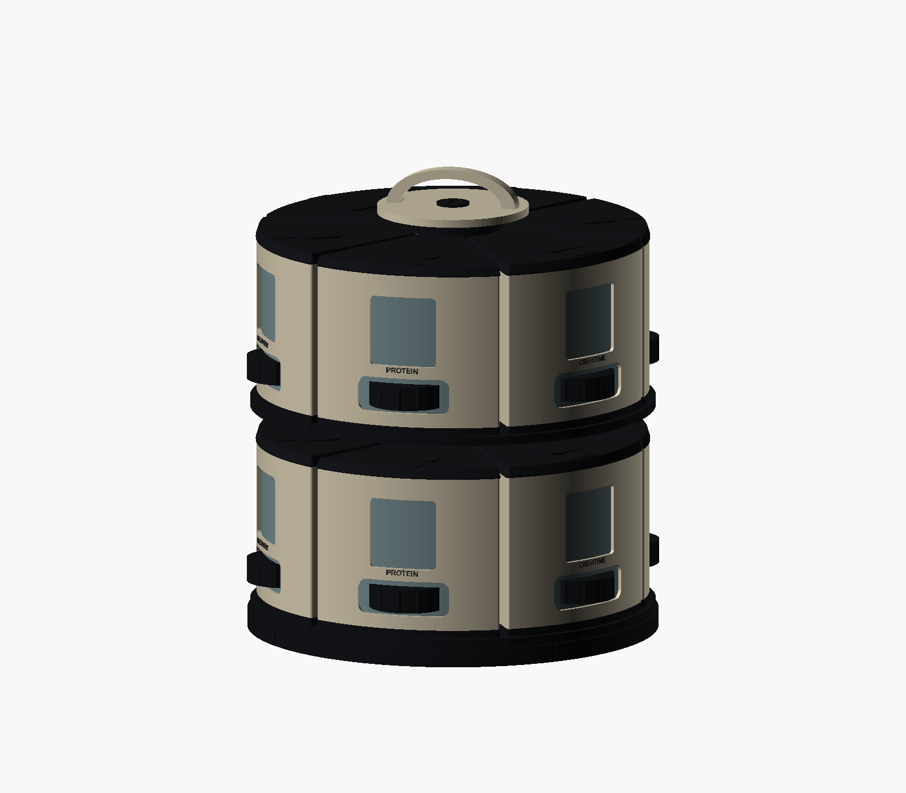

# Carousel V01: visual review and component geometry

**Current owner direction: 12 total cartridges, six wider wedges per tier.** Match the linked video's satin/champagne fronts, black scalloped lids and plinths, rectangular windows and recessed horizontal thumbwheels. Both six-cartridge rings are complete circles. This supersedes the initial five-per-tier drawing and the briefly considered 24-cartridge layout.

This checkpoint supplies editable CAD, separate exterior-component meshes, and images for visual review. It is **not a working dispenser**, and these appearance pieces are not food-use or load-rated print files. Fit, closure, latch, seals, bearing, connector, overhead mount and dosing still need development. No part has been physically printed or tested.

## Preview



| Configuration | Preview |
|---|---|
| One six-cartridge tier | [Image](images/single-tier.png) |
| Tiers separated | [Image](images/separated-tiers.png) |
| Removed cartridge | [Image](images/removed-cartridge.png) |
| Cartridge detail | [Image](images/cartridge.png) |
| Cartridge components | [Image](images/exploded-cartridge.png) |

All previews are rendered from `cad/appearance.scad`, rather than imagined product photos. Label names illustrate layout and do not define ingredients or recipes. The separated view shows a second base/handle as an accessory configuration, not a second base hidden in the assembled unit.

## Approximate size

- Countertop footprint: 314 mm diameter (12.4 inches).
- Two-tier exterior: about 356 mm high (14.0 inches), including top handle.
- Single-tier exterior: about 198 mm high (7.8 inches).
- Cartridge shell: 118 mm body height, plus 6 mm foot and approximately 10 mm lid/thumb pad.
- Sector: 57.8 degrees, outer radius 150 mm and inner radius 37 mm. The wider fronts intentionally differ from the twelve-per-ring commercial reference.
- The outer envelope is not usable capacity. Liner, sloping floor, metering assembly, seals and fill headspace must be resolved before quoting capacity in mL or grams.

## Open or reproduce

Open `cad/appearance.scad` in OpenSCAD. `part="assembly"` is the complete two-tier view. Choose `single`, `separated`, `cartridge`, or a component name to inspect it. Set `removed=true` for the illustrated removal view; `exploded=true` separates the lid and wheel. These are illustration controls, not validated motion paths.

The `exports/` folder contains STL component envelopes for independent viewing or non-food fit exploration. Do not print the complete carousel as a single fused model. Source dimensions are millimeters. Each appearance component is checked against a 256 mm bounding envelope; this alone does not establish printer suitability, orientation, supports or tolerances.

On a Linux build host with OpenSCAD, Xvfb and a Python environment with trimesh/numpy:

```sh
python3 concepts/codex-countertop-carousel/prototype-v01/scripts/build.py
```

The build exports nine components and six views and checks the meshes for a single closed, consistently oriented solid with positive volume. See `validation/mesh-report.json` for results and source/output hashes. No changes to the existing dispenser control software are required or made.

## Mechanism work

`cad/mechanism-study.scad` preserves an early **unvalidated horizontal-axis rotor exploration**. It does not fit or drive this visual model's vertical-axis thumbwheel. It is not part of the export or acceptance workflow, and must not be presented as a compatible working mechanism. The next engineering task is a vertical-shaft rotary pocket cassette beneath the hopper, a positive parked closure, and a removable cleanable bottom plate, all constrained by the approved exterior. A measured volume is not a verified number of grams; weigh the receiving cup.

The under-cabinet variant is intentionally not represented as an engineered mount. It needs the loaded mass, real cabinet structure, secure fasteners, secondary retention and a verified load path before hanging anything overhead.

## Reference provenance

- [Original reel](https://www.instagram.com/reel/DfjxlAlBuUp/), @rgstore369, accessed November 27, 2026. [Captured frame](images/reference-instagram.png). Single-tier cabinet and two-tier countertop scenes were visually inspected. The frame is reference evidence; it is not a render of our design.
- [KitchenArt manufacturer catalog, printed page 315 / PDF page 3](https://www.foxrunbrands.com/wp-content/uploads/2018/12/KitchenArt_HealthyMeasures_2019_US.pdf): Select-A-Spice 57010 satin model is a close visual match. The catalog describes 12 canisters per ring, removable containers, stacking and under-cabinet use. Identification of the video product remains an inference. Its stated 1/4 teaspoon increment is a spice-volume specification, not a protein-powder accuracy claim.
- Video screenshot download was successful; the browser's video-file download failed. No complete local video archive is claimed. Reference media retain their original creator's rights; repository software license does not relicense that screenshot.
