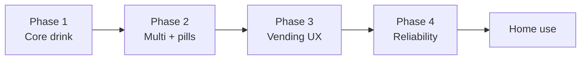

# Project Plan – Vending-Style Supplement Drink Machine

## Target

A self-contained unit that looks like a modern beverage machine.  
User selects supplements on the touchscreen → machine makes a complete mixed drink using powders + water from a refillable tank (and can also dispense pills).

**Capacity (end state):** ~12 supplement stations.

## Core Requirements (Locked)

- Refillable water tank (no permanent water-line connection)
- Visual design similar to the latest concept render (white/black, tall touchscreen, dispensing area)
- Automatic selection of which modules to activate based on touchscreen choice
- Accurate powder dosing + water dosing + mixing

## Why Risk-First

Mixing **water + powder accurately and cleanly** is the highest technical risk. Phase 1 proves one powder station + water + mix on a bench before any 12-station cabinet work. Architecture and phases are detailed in [SYSTEM_ARCHITECTURE.md](SYSTEM_ARCHITECTURE.md) and [diagrams/phase_roadmap.mmd](diagrams/phase_roadmap.mmd).

---

## Recommended Build Order

### Phase 1 – Core Drink Capability (Start Here)

Prove **one** powder station + water + mixing works reliably.

| Workstream | Deliverables |
|------------|--------------|
| Mechanics | Print hopper/auger/stand per [PHASE1_DESIGN_HANDOFF.md](PHASE1_DESIGN_HANDOFF.md) |
| Electronics | Pi, HX711, NEMA17 + driver, vibe motor, PSU, pump, tank |
| Control | Closed-loop powder dosing; water dosing; basic mix |
| UX | Serial/CLI or minimal touchscreen for test recipes only |

**Success =** consistent, accurately dosed drinks with real powder (±0.1 g powder after settle; water within band in [TESTING_PROTOCOL.md](TESTING_PROTOCOL.md)).

### Phase 2 – Multi-Module + Pills

- Expand to multiple powder stations
- Add pill dispensing modules
- Shared collection / mixing area
- Frame that begins to match the vending visual style

### Phase 3 – Full Vending Experience

- Complete ~12-station layout
- Polished touchscreen UI with recipes
- Inventory, alerts, WiFi control
- Enclosure matching the concept look
- Hygiene / easy-clean design

### Phase 4 – Polish & Reliability

- Calibration routines, jam recovery, low-water detection hardened
- Long-term soak testing and daily-use readiness

---

## Phase Exit Criteria

### Phase 1 exit (must all pass)

- [ ] Powder module prints, assembles, and free-runs without mechanical bind
- [ ] Scale calibrated; stable tare with empty cup
- [ ] **20× @ 3 g** and **20× @ 5 g** closed-loop powder tests within **±0.1 g** after settle (per powder type under test)
- [ ] Water volume accuracy within **±5–10 ml** (or better with weight-based dosing)
- [ ] At least **5** full powder + water + mix drinks without critical fault
- [ ] Documented failure handling for empty/jam/no-cup (even if simple)
- [ ] Safety/hygiene basics followed ([SAFETY_AND_HYGIENE.md](SAFETY_AND_HYGIENE.md))

### Phase 2 exit

- [ ] ≥2 powder stations dose into the same drink path without cross-contamination disaster (wipe-down acceptable)
- [ ] Pill module dispenses correct count in open tests
- [ ] Shared frame holds modules at correct outlet height above cup/scale
- [ ] Multi-ingredient recipe completes end-to-end on bench or proto frame

### Phase 3 exit

- [ ] User can select recipes on touchscreen without CLI
- [ ] Station map + inventory estimate works for active stations
- [ ] Enclosure is usable as a freestanding appliance (doors, drip tray, tank access)
- [ ] Cleaning procedure written and walk-through once

### Phase 4 exit

- [ ] Jam / empty / low-water recovery paths tested under fault injection
- [ ] Scale drift check / recalibration procedure is routine and documented
- [ ] Multi-day soak (e.g. 50–100 automated dispenses) without unattended unsafe failure
- [ ] Decision: “daily home use” yes / more iteration

---

## Decision Points

Make these explicitly; do not silently reverse locked Phase 1 geometry without a design note.

| ID | When | Decision | Options / guidance |
|----|------|----------|--------------------|
| D1 | After first powder prints | Auger pitch / clearance OK? | Iterate STL variants before software tuning |
| D2 | After open-loop powder tests | Proceed to closed-loop? | Only if mass increases predictably and no permanent bridge |
| D3 | During water bring-up | Water strategy for Phase 1 | Timed → prefer weight-on-scale; flow sensor optional upgrade |
| D4 | End of Phase 1 | Powder accuracy sustainable? | If ±0.1 g fails after geometry + control tuning, reassess hopper/auger before multi-station |
| D5 | Start Phase 2 | Shared scale vs multi-scale | Prefer single cup scale until layout forces otherwise |
| D6 | Mid Phase 2 | Pill mechanism type | Gravity tube + disk vs blister-style; pick one and stick for first module |
| D7 | Start Phase 3 | UI stack | Pi-native touch UI vs web UI on local server |
| D8 | Enclosure | Food-zone materials | Confirm food-contact list before sealing the cabinet design |
| D9 | Phase 4 | Daily-use go/no-go | Reliability metrics + hygiene burden acceptable? |

**Hard locks (do not reopen casually):** refillable tank (no house water line); closed-loop powder weighing; Phase 1 hopper geometry targets (65° wall, 90 mm top ID, 22 mm outlet) in the design handoff.

---

## Suggested Week-by-Week Schedule

Assumes evenings/weekends hobby pace, parts already ordered or arriving early. Compress if full-time; stretch if prints fail.

### Weeks 1–2 — Phase 1 foundations

| Week | Focus | Outcomes |
|------|--------|----------|
| **1** | CAD/print powder module; dry-fit NEMA17 + vibe; mount load cell platform | Parts on bench; [ASSEMBLY_GUIDE.md](ASSEMBLY_GUIDE.md) steps 1–wiring prep |
| **2** | Wire electronics; scale calibration; software dry run (no powder); open-loop pulse tests | Calibrated scale; motors respond; safe E-stop habit |

### Weeks 3–4 — Powder closed loop

| Week | Focus | Outcomes |
|------|--------|----------|
| **3** | Real powder open-loop characterization; closed-loop bursts; settle tuning | First in-band 3 g / 5 g hits |
| **4** | Formal 20× tests @ 3 g and 5 g; jam/empty behavior | Phase 1 powder exit criteria met or geometry revision cycle |

### Weeks 5–6 — Water + full drink

| Week | Focus | Outcomes |
|------|--------|----------|
| **5** | Tank, pump, plumbing; timed water cal; leak check | Water path reliable on bench |
| **6** | Weight- or flow-based water refine; mix; 5+ full drinks; hygiene pass | **Phase 1 exit** |

### Weeks 7–10 — Phase 2 start (indicative)

| Week | Focus | Outcomes |
|------|--------|----------|
| **7–8** | Second powder station; shared mounting | Dual powder recipe |
| **9–10** | Pill module v0; multi-ingredient drinks | Phase 2 exit path clear |

### Weeks 11–16 — Phase 3 (indicative)

- Frame/enclosure, touchscreen recipes, inventory, cleanability.
- Exit when product-like UX works without CLI.

### Weeks 17+ — Phase 4

- Fault injection, soak tests, calibration schedule, daily-use decision (D9).

---

## Workstream Ownership (repo)

| Area | Location | Notes |
|------|----------|--------|
| Plans & protocols | `docs/` | This plan + architecture + assembly + test + safety |
| Mechanics | `3d_models/`, `hardware/` | STLs and mechanical notes (other agents / human CAD) |
| Software | `software/` | Implemented separately from this doc set |
| BOM | [BOM.md](BOM.md) | Order Phase 1 parts first |

---

## Non-Goals by Phase (reminders)

| Phase | Explicitly out of scope |
|-------|-------------------------|
| 1 | 12-station frame, pills, polished UI, WiFi |
| 2 | Final enclosure cosmetics, full inventory cloud |
| 3 | Medical claims, commercial certification |
| 4 | Shipping/productization unless you choose that path |

---

## Document Index

| Document | Purpose |
|----------|---------|
| [SYSTEM_ARCHITECTURE.md](SYSTEM_ARCHITECTURE.md) | Blocks, control loops, failures, recipes |
| [SOFTWARE_ARCHITECTURE.md](SOFTWARE_ARCHITECTURE.md) | Software layers (no implementation here) |
| [PHASE1_DESIGN_HANDOFF.md](PHASE1_DESIGN_HANDOFF.md) | Locked powder module geometry |
| [ASSEMBLY_GUIDE.md](ASSEMBLY_GUIDE.md) | Phase 1 step-by-step build |
| [TESTING_PROTOCOL.md](TESTING_PROTOCOL.md) | Calibration and pass/fail tests |
| [SAFETY_AND_HYGIENE.md](SAFETY_AND_HYGIENE.md) | Food contact, cleaning, disclaimers |
| [BOM.md](BOM.md) | Parts |
| [diagrams/](diagrams/) | Mermaid sources for overview, sequence, roadmap |
