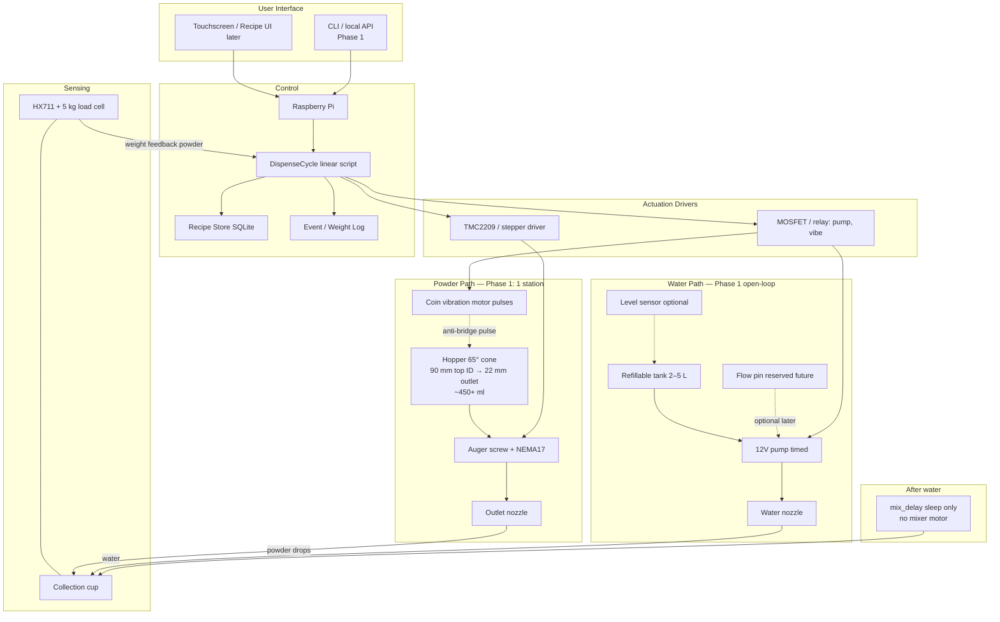
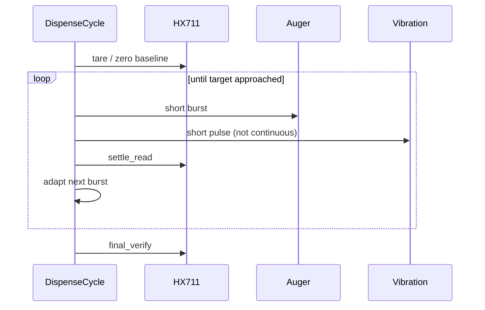

# System Architecture – DIY Supplement Dispenser

High-level hardware + control architecture for the vending-style supplement drink machine. Phase 1 proves **one powder station + open-loop water + settle delay** on a bench rig; later phases add stations, pills, and enclosure without changing the core control ideas.

Related diagrams:

- [diagrams/system_overview.mmd](diagrams/system_overview.mmd)
- [diagrams/dispense_sequence.mmd](diagrams/dispense_sequence.mmd)
- [diagrams/phase_roadmap.mmd](diagrams/phase_roadmap.mmd)

Mechanical geometry for the Phase 1 powder module is locked in [PHASE1_DESIGN_HANDOFF.md](PHASE1_DESIGN_HANDOFF.md). Software layering is in [SOFTWARE_ARCHITECTURE.md](SOFTWARE_ARCHITECTURE.md).

---

## 1. Goals and Constraints

| Goal | Approach |
|------|----------|
| Accurate powder dose | Closed-loop weighing under the cup (**±0.1 g goal** after settle) |
| Water for a complete drink | Refillable tank; **Phase 1: open-loop timed pump** after calibration |
| “Mix” | **Settle delay only** in Phase 1 (no dedicated mixer motor) |
| Scale later | Modular stations; shared orchestrator and recipe model |
| Safety / hygiene | Food-contact paths isolated from mains; cleanable printed parts |

**Not goals for Phase 1:** multi-hopper frame, pill module, polished UI, WiFi inventory, closed-loop water, automatic stirring hardware.

---

## 2. Block Diagram



Source: [diagrams/system_overview.mmd](diagrams/system_overview.mmd).

### 2.1 Physical paths (Phase 1)

1. **Powder:** Hopper → throat → auger barrel → outlet nozzle → free fall into cup on scale.  
2. **Water:** Tank → pump → nozzle into same cup. **Timed open-loop** after calibrating ml/s. Flow sensor GPIO is **reserved for future**, not required for Phase 1.  
3. **Sense:** Single HX711 + load cell under cup; all closed-loop **powder** decisions use this reading.  
4. **Mix:** After powder + water, software waits `mix_delay_seconds` (settle / dissolve time). Manual swirl is fine for early tests. **No Phase 1 mixer motor.**

Power domains should keep **12 V actuation** (pump, stepper supply) separate from **5 V / 3.3 V logic** (Pi, HX711, sensors), with common ground and fused 12 V.

---

## 3. Powder Dosing Control Loop

Accuracy is **closed-loop on mass**, not open-loop step counts alone. Open-loop is used only for characterization and as an inner “burst” actuator.

### 3.1 Sequence (summary)



Full sequence including water/settle/faults: [diagrams/dispense_sequence.mmd](diagrams/dispense_sequence.mmd).

### 3.2 Loop stages

| Stage | Action | Notes |
|-------|--------|-------|
| **Preflight** | Confirm cup present when required; e-stop not asserted | Abort on NO_CUP |
| **Zero** | Tare (or record baseline) with empty cup | Do not zero after powder starts |
| **Burst dose** | Run auger for short time; optional concurrent **vibe pulse** | Start conservative; adapt |
| **Settle** | Wait for weight filter to stabilize | Tune empirically |
| **Measure** | Filtered mass vs target | Remaining = target − current |
| **Adapt** | Shrink burst size as remaining shrinks | Avoid overshoot |
| **Verify** | After final settle, accept if within ±0.1 g **goal** | Else fail / top-up policy |
| **Empty / jam** | If Δmass ≈ 0 over window → reverse-auger then EMPTY/JAM | Operator clears / refills |

### 3.3 Burst sizing heuristic (conceptual)

- **Coarse phase:** larger bursts while remaining is large.  
- **Fine phase:** short timed pulses near target.  
- **Overshoot margin:** stop bursts slightly early if the powder stream free-falls after motor stop.  
- **Vibration:** **short pulses** during dosing to break bridges; not continuous vibe for the whole dose; vibe off before final settle read.

### 3.4 Why not open-loop powder only?

Supplement powders vary in density, humidity, and packing. Step-to-gram ratios drift. Closed-loop under the cup is the Phase 1 powder success path; open-loop ratios are only for speed-up and diagnostics.

---

## 4. Water Dosing (Honest Phase 1)

Phase 1 ships **one method**: open-loop timed pump. Other strategies are future options, not implemented claims.

### 4.1 Timed pump (Phase 1 — implemented path)

| | |
|--|--|
| **Method** | Calibrate ml/s at known head height; run pump for `t = V / rate`. |
| **Pros** | Minimal sensors; easy first drink. |
| **Cons** | Rate depends on tank level, tubing, voltage, wear; drift over session. |
| **Mitigations** | Calibrate at half-tank with graduated cylinder; re-cal after tubing changes; optional level interlock. |

Success is a **calibrated timed dose** verified offline — not automatic closed-loop correction of every pour.

### 4.2 Flow sensor (future / reserved pin)

| | |
|--|--|
| **Status** | GPIO reserved; **not** Phase 1 dosing software |
| **Method** | Inline hall/turbine; stop at N pulses ≈ target volume |
| **When** | After timed path is proven and drift becomes painful |

### 4.3 Weight of water on the same scale (future)

| | |
|--|--|
| **Status** | Not Phase 1 software |
| **Method** | After powder verify, closed-loop pump on Δmass (1 g ≈ 1 ml) |
| **When** | Optional upgrade once powder loop is solid |

### 4.4 Phase 1 recommendation

1. **Bring-up and production path:** timed pump + measuring cup / graduated cylinder calibration.  
2. **Do not claim** flow or weight-of-water as current features.  
3. **Success band:** water volume within **±5–10 ml** of target after calibration — see [TESTING_PROTOCOL.md](TESTING_PROTOCOL.md).

---

## 5. Recipe Data Model (Outline)

Software owns schemas; this is the architecture-level outline only.

```text
Recipe
  id, name, version
  ingredients[]:
    - kind: powder | water | (pill later)
    - target_amount   # grams | ml
  mix_delay_seconds   # sleep only — no mixer motor in Phase 1

DispenseJob / CycleResult (runtime)
  recipe_id, started_at
  steps[] with measured vs target
  faults / messages, final_status
```

Phase 1 uses SQLite recipes seeded for demos (e.g. powder g + water ml).

---

## 6. Failure Modes

| Failure | Detection | Response |
|---------|-----------|----------|
| **Powder jam / bridge** | No mass increase over window despite auger motion | Reverse-auger / vibe pulse; then JAM fault and stop |
| **Empty hopper** | Same after recovery fails | EMPTY fault; operator refill |
| **Low water** | Level sensor low; pump timeout | LOW_WATER; inhibit pump; prompt refill |
| **Scale drift / noise** | Unstable zero; cal weight fail | Require recalibration ([TESTING_PROTOCOL.md](TESTING_PROTOCOL.md)) |
| **No cup** | Cup sensor or weight threshold | NO_CUP; do not dose |
| **Overshoot powder** | Final mass > target + tolerance | Fail or WARN per product policy |
| **Pump dry-run** | Max run time / level empty | Stop pump; protect pump |
| **Spill / overflow** | Total mass > cup capacity limit (if enforced) | Emergency stop all actuators |
| **E-stop** | GPIO25 (optional) asserted | All motion off |

All faults should leave actuators **off**, log the job, and surface a clear operator action. See [SAFETY_AND_HYGIENE.md](SAFETY_AND_HYGIENE.md).

---

## 7. Phase 1 Bench Layout (Logical)

```text
  [ Hopper + auger module on stand  — v0.2: auger from free end ]
           | powder drop
           v
  [ Cup ] ---- sits on ---- [ Load cell platform ]
           ^
           | water nozzle (side or above)
  [ Tank ] --timed pump--> nozzle

  [ Pi + drivers + PSU ] nearby, liquids routed away from electronics
```

Drop distance short and direct (no long chute) for Phase 1 accuracy testing, per design handoff. Hopper capacity ≈ **450+ ml** (frustum + cylinder).

---

## 8. Expansion Path (Phases 2–4)

| Phase | Architecture impact |
|-------|---------------------|
| **2** | N powder stations; pill actuator; station map in recipes |
| **3** | Touchscreen UI; inventory; WiFi; enclosure |
| **4** | Hardened fault recovery, scheduled cal, soak tests |
| **Optional anytime** | Flow-sensor water or weight-of-water; real mixer motor |

Roadmap diagram: [diagrams/phase_roadmap.mmd](diagrams/phase_roadmap.mmd).

---

## 9. Document Map

| Doc | Role |
|-----|------|
| [PROJECT_PLAN.md](PROJECT_PLAN.md) | Phases, schedule, exit criteria |
| [PHASE1_DESIGN_HANDOFF.md](PHASE1_DESIGN_HANDOFF.md) | Locked powder module geometry |
| [SOFTWARE_ARCHITECTURE.md](SOFTWARE_ARCHITECTURE.md) | Software layers and real modules |
| [ASSEMBLY_GUIDE.md](ASSEMBLY_GUIDE.md) | Build and first drink |
| [TESTING_PROTOCOL.md](TESTING_PROTOCOL.md) | Calibration and success criteria |
| [SAFETY_AND_HYGIENE.md](SAFETY_AND_HYGIENE.md) | Food contact, cleaning, disclaimers |
| [BOM.md](BOM.md) | Parts list |
