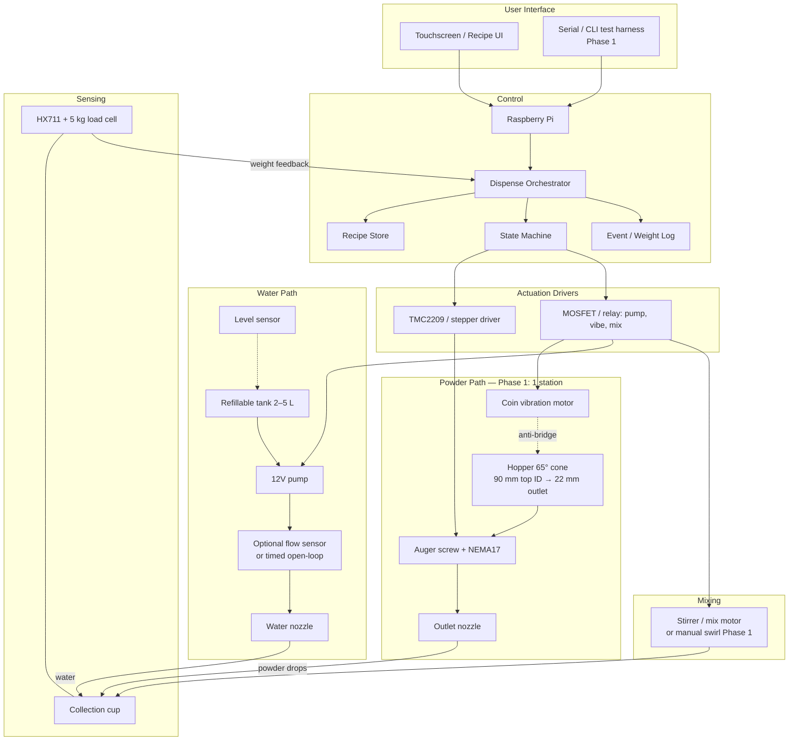
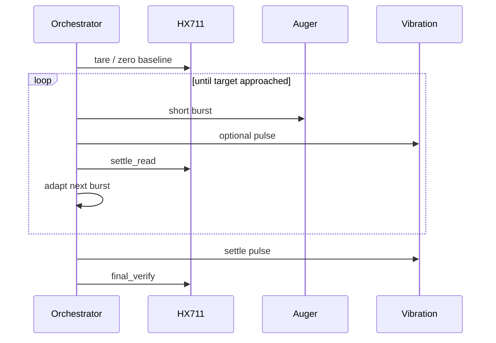

# System Architecture – DIY Supplement Dispenser

High-level hardware + control architecture for the vending-style supplement drink machine. Phase 1 proves **one powder station + water + mix** on a bench rig; later phases add stations, pills, and enclosure without changing the core control ideas.

Related diagrams:

- [diagrams/system_overview.mmd](diagrams/system_overview.mmd)
- [diagrams/dispense_sequence.mmd](diagrams/dispense_sequence.mmd)
- [diagrams/phase_roadmap.mmd](diagrams/phase_roadmap.mmd)

Mechanical geometry for the Phase 1 powder module is locked in [PHASE1_DESIGN_HANDOFF.md](PHASE1_DESIGN_HANDOFF.md). Software layering is in [SOFTWARE_ARCHITECTURE.md](SOFTWARE_ARCHITECTURE.md).

---

## 1. Goals and Constraints

| Goal | Approach |
|------|----------|
| Accurate powder dose | Closed-loop weighing under the cup (±0.1 g after settle) |
| Water for a complete drink | Refillable tank (no hard plumbing); timed / flow / weight strategies |
| Mix | Stirrer or controlled swirl into the same cup |
| Scale later | Modular stations; shared orchestrator and recipe model |
| Safety / hygiene | Food-contact paths isolated from mains; cleanable printed parts |

**Not goals for Phase 1:** multi-hopper frame, pill module, polished UI, WiFi inventory.

---

## 2. Block Diagram



Source: [diagrams/system_overview.mmd](diagrams/system_overview.mmd).

### 2.1 Physical paths (Phase 1)

1. **Powder:** Hopper → throat → auger barrel → outlet nozzle → free fall into cup on scale.  
2. **Water:** Tank → pump → (optional flow sensor) → nozzle into same cup.  
3. **Sense:** Single HX711 + load cell under cup; all closed-loop powder decisions use this reading.  
4. **Mix:** After powder + water, stir in cup (or Phase 1: manual swirl for early tests).

Power domains should keep **12 V actuation** (pump, optional mix motor, stepper supply) separate from **5 V / 3.3 V logic** (Pi, HX711, sensors), with common ground and fused 12 V.

---

## 3. Powder Dosing Control Loop

Accuracy is **closed-loop on mass**, not open-loop step counts alone. Open-loop is used only for characterization and as an inner “burst” actuator.

### 3.1 Sequence (summary)



Full sequence including water/mix/faults: [diagrams/dispense_sequence.mmd](diagrams/dispense_sequence.mmd).

### 3.2 Loop stages

| Stage | Action | Notes |
|-------|--------|-------|
| **Preflight** | Confirm cup present, scale stable, hopper not flagged empty | Abort on NO_CUP / SCALE_FAULT |
| **Zero** | Tare (or record baseline) with empty cup | Do not zero after powder starts |
| **Burst dose** | Run auger for short time or N steps; optional concurrent vibe | Start conservative; adapt |
| **Settle** | Wait for weight filter to stabilize (vibration decay + powder settle) | Typical settle window: tens to hundreds of ms; tune empirically |
| **Measure** | Filtered mass vs target | Remaining = target − current |
| **Adapt** | Shrink burst size as remaining shrinks; optional coarse then fine phase | Avoid overshoot |
| **Verify** | After final settle, accept if within ±0.1 g | Else WARN/ABORT or micro-top-up policy (product decision) |
| **Empty / jam** | If Δmass ≈ 0 over K consecutive bursts → longer vibe, then EMPTY/JAM fault | Operator clears / refills |

### 3.3 Burst sizing heuristic (conceptual)

- **Coarse phase:** larger bursts while `remaining > fine_threshold` (e.g. > 0.5 g).  
- **Fine phase:** small steps or short timed pulses near target.  
- **Overshoot margin:** stop bursts slightly early if the powder stream free-falls after motor stop; learn per-powder lag mass.  
- **Vibration:** short pulses during dosing to break bridges; longer pulse only on no-progress; brief settle vibe before final read.

### 3.4 Why not open-loop only?

Supplement powders vary in density, humidity, and packing. Step-to-gram ratios drift. Closed-loop under the cup is the Phase 1 success path; open-loop ratios are only for speed-up and diagnostics.

---

## 4. Water Dosing Strategies

Phase 1 may implement one strategy first, then compare. All assume a **refillable tank** and a nozzle that discharges into the same cup.

### 4.1 Timed pump (simplest)

| | |
|--|--|
| **Method** | Calibrate ml/s at known head height; run pump for `t = V / rate`. |
| **Pros** | Minimal sensors; easy first drink. |
| **Cons** | Rate depends on tank level, tubing, voltage, wear; drift over session. |
| **Mitigations** | Calibrate at half-tank; re-cal after tubing changes; optional level-based rate table. |

### 4.2 Flow sensor (pulse counting)

| | |
|--|--|
| **Method** | Inline hall/turbine sensor; stop at N pulses ≈ target volume. |
| **Pros** | Better than pure time for mid-session level change. |
| **Cons** | Sensor cost; low-flow accuracy; air bubbles; food-grade path. |
| **Mitigations** | Prime line; debounce pulses; max-time timeout (dry-run protection). |

### 4.3 Weight of water on the same scale

| | |
|--|--|
| **Method** | After powder verify, use Δmass of water (1 g ≈ 1 ml) to closed-loop the pump. |
| **Pros** | Same sensor stack; good absolute accuracy if powder mass already known. |
| **Cons** | Mixing of errors if powder still settling; cup splash; max cup weight vs load cell range. |
| **Mitigations** | Stable powder reading first; soft pump duty; stop early for overshoot; verify total mass = powder + water. |

### 4.4 Recommendation for Phase 1

1. **Bring-up:** timed pump with a measuring cup offline calibration.  
2. **Accuracy goal:** prefer **weight-of-water** on the existing HX711 once powder loop is solid (fewest new parts).  
3. **Optional upgrade:** flow sensor if weight-of-water conflicts with mixer mass or multi-nozzle plumbing later.

**Success band (see [TESTING_PROTOCOL.md](TESTING_PROTOCOL.md)):** water volume within **±5–10 ml** of target (tighter if weight-based).

---

## 5. Recipe Data Model (Outline)

Software owns schemas; this is the architecture-level outline only.

```text
Recipe
  id, name, version
  servings / default cup size
  ingredients[]:
    - station_id | ingredient_type   # powder | pill | water
    - target_amount                  # grams | count | ml
    - order / phase                  # powder first, then water, then mix
    - optional tolerances            # override global ±0.1 g etc.
  mix:
    - duration_ms, speed (if controllable)
  metadata:
    - notes, tags, active flag
    - created/updated

IngredientCatalog (later)
  id, display_name, type
  density_hint, flow_class           # for burst heuristics
  allergen / caution flags           # UI only; not medical claims

StationMap
  station_id → hardware binding
    powder: stepper channel, vibe GPIO, hopper capacity estimate
    pill: actuator channel
    water: pump + strategy params

DispenseJob (runtime)
  recipe_id, started_at
  steps[] with measured vs target
  faults[], final_status
```

Phase 1 can hardcode a single recipe (`powder_g`, `water_ml`, `mix_ms`) and grow into JSON/YAML store in Phase 3.

---

## 6. Failure Modes

| Failure | Detection | Response |
|---------|-----------|----------|
| **Powder jam / bridge** | No mass increase over K bursts despite auger motion | Longer vibe cycle; retry; then JAM fault and stop |
| **Empty hopper** | Same as jam after vibe recovery fails; optional hopper level later | EMPTY fault; operator refill; do not keep spinning |
| **Low water** | Level sensor low; pump timeout with no flow/weight increase | LOW_WATER; inhibit pump; prompt refill |
| **Scale drift / noise** | Unstable zero; large jumps without actuation; cal weight fail | SCALE_FAULT; require recalibration ([TESTING_PROTOCOL.md](TESTING_PROTOCOL.md)) |
| **No cup** | Weight below empty-platform threshold or cup-detect switch | NO_CUP; do not dose |
| **Overshoot powder** | Final mass > target + tolerance | Log WARN; optional product policy: continue drink vs abort |
| **Pump dry-run** | Max run time without Δvolume/Δweight | Stop pump; protect pump; LOW_WATER / PLUMBING fault |
| **Stepper fault** | Driver fault pin / no motion while scale stuck (if instrumented) | Disable driver; fault UI |
| **Spill / overflow** | Total mass > cup capacity limit | Emergency stop all actuators |
| **Power brownout** | Undervoltage (if monitored) | Safe stop; leave partial job as ABORTED |

All faults should leave actuators **off**, log the job, and surface a clear operator action. See [SAFETY_AND_HYGIENE.md](SAFETY_AND_HYGIENE.md).

---

## 7. Phase 1 Bench Layout (Logical)

```text
  [ Hopper + auger module on stand ]
           | powder drop
           v
  [ Cup ] ---- sits on ---- [ Load cell platform ]
           ^
           | water nozzle (side or above)
  [ Tank ] --pump--> nozzle

  [ Pi + drivers + PSU ] nearby, liquids routed away from electronics
```

Drop distance short and direct (no long chute) for Phase 1 accuracy testing, per design handoff.

---

## 8. Expansion Path (Phases 2–4)

| Phase | Architecture impact |
|-------|---------------------|
| **2** | N powder stations (N steppers/vibes); pill actuator; shared cup/scale or per-lane policy; station map in recipes |
| **3** | Touchscreen UI bound to recipe store; inventory counters; WiFi; enclosure; hygiene features |
| **4** | Hardened fault recovery, scheduled cal, soak tests, production-like reliability |

Roadmap diagram: [diagrams/phase_roadmap.mmd](diagrams/phase_roadmap.mmd).

---

## 9. Document Map

| Doc | Role |
|-----|------|
| [PROJECT_PLAN.md](PROJECT_PLAN.md) | Phases, schedule, exit criteria |
| [PHASE1_DESIGN_HANDOFF.md](PHASE1_DESIGN_HANDOFF.md) | Locked powder module geometry |
| [SOFTWARE_ARCHITECTURE.md](SOFTWARE_ARCHITECTURE.md) | Software layers and modules |
| [ASSEMBLY_GUIDE.md](ASSEMBLY_GUIDE.md) | Build and first drink |
| [TESTING_PROTOCOL.md](TESTING_PROTOCOL.md) | Calibration and success criteria |
| [SAFETY_AND_HYGIENE.md](SAFETY_AND_HYGIENE.md) | Food contact, cleaning, disclaimers |
| [BOM.md](BOM.md) | Parts list |
