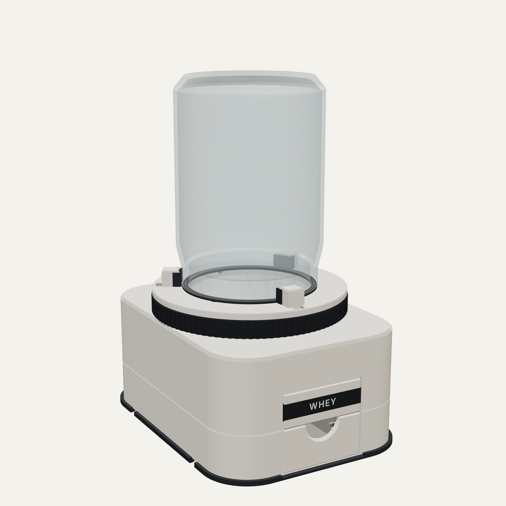
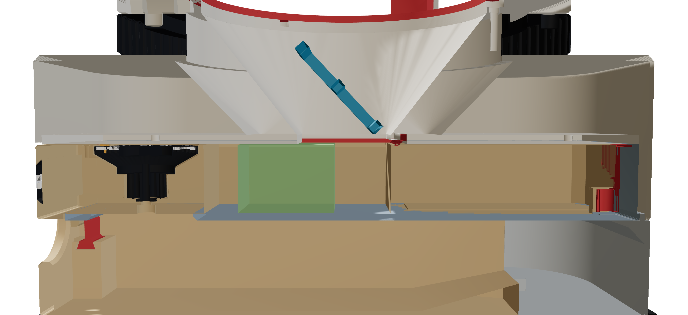
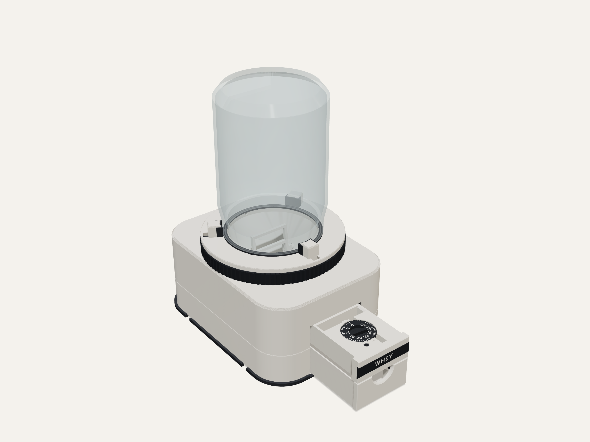
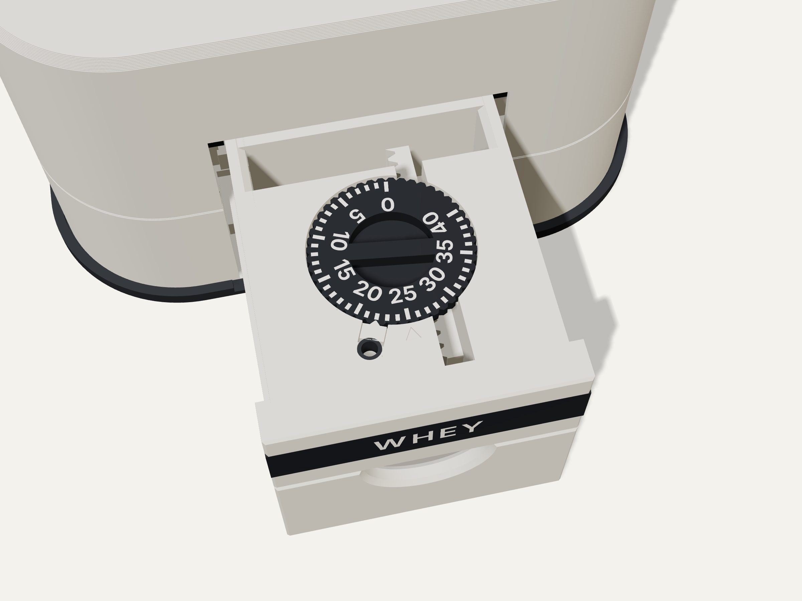
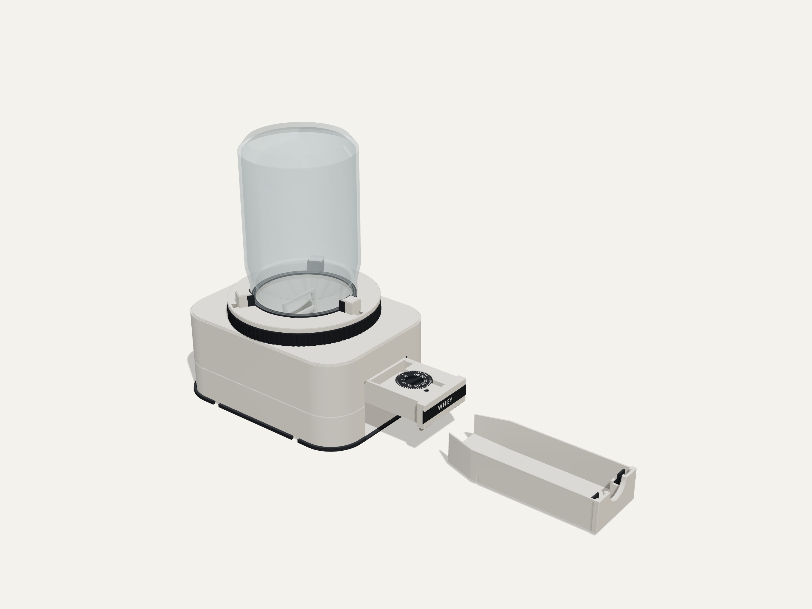
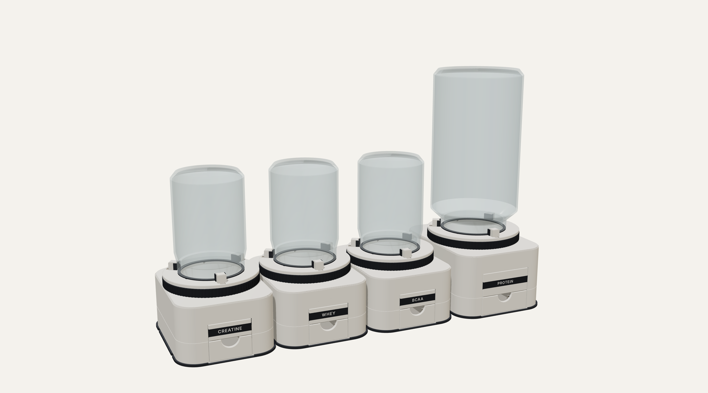
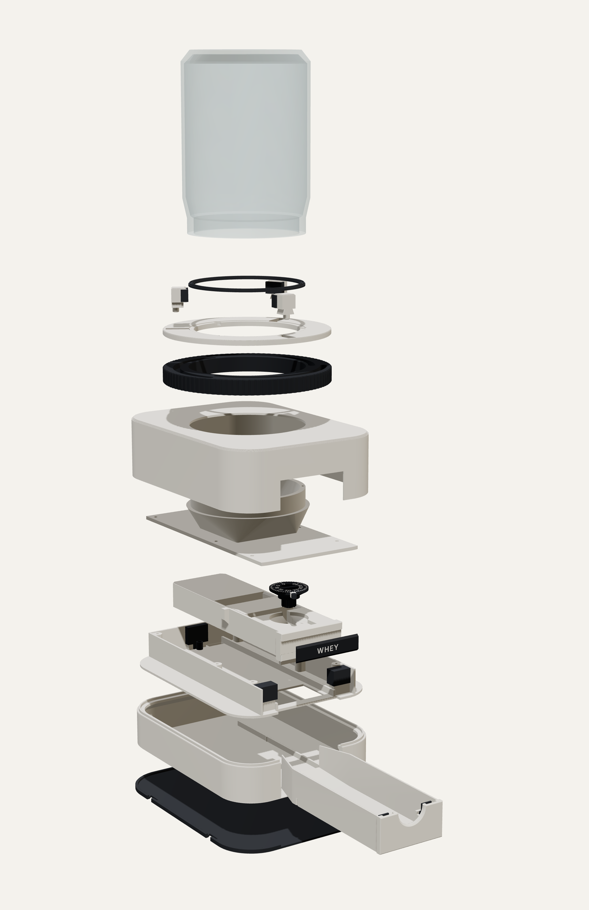

# Dose Bar v6

A manual powder dispenser for supplement jars you already own. No electronics, no springs, nothing to buy:
PLA, TPU and a handful of M3 screws.

| | |
|---|---|
| **One pull = one dose** | Pull the scoop drawer: it brings the dose slide with it, the measured dose drops in, a tug releases the scoop. Pour, push back. |
| **Set and forget** | A 48-click dial sets the dose in mL. It sits on the slide and is hidden inside the body until you pull. |
| **Your own jars, no drilling** | The jar stands upside down in a twist-lock chuck (like a drill chuck) that grips the neck. |
| **Expandable** | One drivetrain, three head sizes (0–20, 0–40, 0–100 mL). A new jar is five measurements in a preset file. |
| **Printable at home** | Every part prints without supports on a 256 mm bed. |

## How it works

1. Powder falls from the jar through the funnel into a **chamber** in the slide. A plunger sets the chamber's length; the dial moves the plunger through a small rack and pinion.
2. Pulling moves the chamber forward. The throat's front edge **strikes it level**; the chamber then travels **sealed** (closed above and below) until it is over the drop hole. Powder can never pour straight through.
3. The dose falls into the **scoop**, which travelled with the slide. Two TPU flaps couple scoop and slide and let go at a firm tug.
4. A rocking **gate** in the funnel stirs the powder at the end of every stroke so sticky powders do not bridge. It is driven through a TPU finger that flexes away if the gate ever jams.

| | |
|---|---|
|  |  |
|  |  |

## Build one

1. [Print guide](PRINT_GUIDE.md): what to print, in what order, with what settings.
2. [Assembly](ASSEMBLY.md): eleven M3 screws, about 20 minutes.
3. [Use, calibrate, clean](USE_AND_CALIBRATE.md): dial chart by powder type, caffeine rules.
4. [Handoff](HANDOFF.md): design decisions, how to rebuild the STLs, open questions.

Spin the 3D model: open `viewer/index.html` (served from this folder), or see the link in the pull request.

## Size

| | Standard head + 6.5 in jar | Protein head + 11.5 in jar |
|---|---|---|
| Footprint | 156 × 213 mm | 170 × 229 mm |
| Height | about 280 mm | about 425 mm |
| Row pitch | 162 mm | 176 mm |
