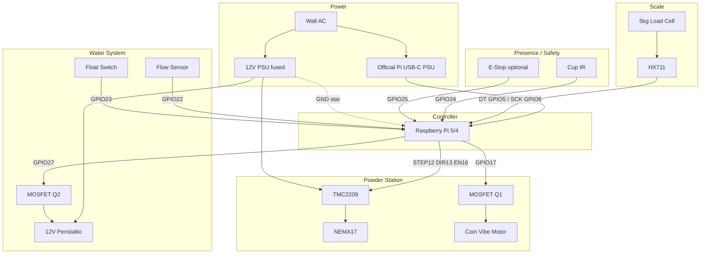

# Phase 1 Electrical Schematic

Signal and power paths for the single-station drink test rig.  
Companion pin table: [PINOUT.md](PINOUT.md) · Wiring practices: [WIRING.md](WIRING.md).

---

## 1. System Block Diagram



Source also maintained at [docs/diagrams/wiring_phase1.mmd](../docs/diagrams/wiring_phase1.mmd).

---

## 2. Power Tree (ASCII)

```
                         Wall AC Mains
                              |
              +---------------+---------------+
              |                               |
     Official Pi USB-C PSU              12 V DC PSU
     (5 V / PD as rated)                 (bench or brick)
              |                               |
              v                               v
        Raspberry Pi                    Fuse F1 3–5 A
        5V/3V3 regulators                     |
              |                               v
              |                      +--------12V_BUS--------+
              |                      |           |           |
              |                   TMC2209      Pump +    Optional
              |                     VM        (to motor)  Buck 12→5
              |                      |           |           |
              |                   NEMA17      MOSFET      5V_AUX
              |                   coils       low-side    (vibe / sensors)
              |                      |        Q2 Drain        |
              |                      |           |         Vibe +
              |                      |        Pump −          |
              |                      |           |         MOSFET
              |                      |           |         Q1 Drain
              |                      |           |            |
              +------ GND_STAR ------+-----------+------------+
                      (single point: Pi GND, PSU−, chassis)
```

Mermaid source: [docs/diagrams/power_tree.mmd](../docs/diagrams/power_tree.mmd).

---

## 3. Logic / Signal Schematic (ASCII)

```
                    Raspberry Pi GPIO (BCM)
    =============================================================
     3V3 --+-- HX711 VCC
           +-- TMC VIO
           +-- (optional sensor VCC if 3.3 V modules)

     5V  --+-- (optional) Flow sensor VCC
           +-- (default) Coin vibe motor +
           +-- (optional) IR module VCC if 5 V and level-safe OUT

     GND ---- GND_STAR

     GPIO5  <---------------- DT ---- HX711
     GPIO6  ----------------> SCK --- HX711

     GPIO12 ---------------> STEP --- TMC2209
     GPIO13 ---------------> DIR  --- TMC2209
     GPIO16 ---------------> ENN  --- TMC2209   (active LOW)

     GPIO17 --[Rg 150Ω]--> G of Q1 (vibe)     +--[Rpd 47k]-- GND
     GPIO27 --[Rg 150Ω]--> G of Q2 (pump)     +--[Rpd 47k]-- GND

     GPIO22 <-----[level safe]---- Flow sensor OUT
     GPIO23 <---- pull-up -------- Float (to GND when closed)
     GPIO24 <-----[level safe]---- Cup IR DO
     GPIO25 <---- pull-up -------- E-stop NC to GND
    =============================================================
```

---

## 4. MOSFET Low-Side Switch (Discrete)

Use for **vibe** (Q1) and **pump** (Q2). Logic-level N-channel MOSFET required at 3.3 V gate.

```
                    +V_LOAD  (5V for vibe default; 12V for pump)
                       |
                    [Motor / Pump]
                       |
                      (D) Drain
                       |
                 N-MOSFET  (e.g. IRLZ44N, IRLZ34, or logic FET module)
                      (S) Source -------- GND_STAR
                       |
                      (G) Gate
                       |
          GPIO --[Rg 100..220Ω]--+--[Rpd 10..100kΩ]-- GND
                                 |
                            optional TVS/gate zener if long cable

    Flyback diode (inductive loads):
                    +V_LOAD ----|>|---- Drain/motor− node
                              cathode     anode
         (diode across motor: cathode on +, anode on − / drain)
```

**Notes:**

- `Rg` slows edge slightly and protects GPIO from gate capacitance.
- `Rpd` keeps MOSFET **off** during Pi boot (GPIOs float briefly).
- Pre-made “MOSFET switch modules” often include opto, Rg, Rpd, and diode — preferred for speed of build.
- Relay modules: OK for pump; slower; ensure coil supply is not the Pi 3.3 V rail.

---

## 5. TMC2209 Standalone STEP/DIR

Phase 1: **no UART**. Configure microsteps with board jumpers (MS1/MS2).

```
  12V_BUS ---- VM
  3V3     ---- VIO / VDD_IO
  GND     ---- GND

  Pi GPIO12 ---- STEP
  Pi GPIO13 ---- DIR
  Pi GPIO16 ---- ENN (LOW = enabled)

  TMC A1 ---- motor coil A
  TMC A2 ---- motor coil A return
  TMC B1 ---- motor coil B
  TMC B2 ---- motor coil B return

  DIAG / INDEX / PDN_UART: leave per board default (often open or pull-up)
```

**Standalone vs UART:**

| Mode | Phase 1 | Pros | Cons |
|------|---------|------|------|
| STEP/DIR | **Yes (default)** | Simple, libraries plentiful, no serial stack | Fixed current via pot; microstep via jumpers |
| UART | Later optional | Runtime current, stealthChop, diagnostics | More software, pin or bus conflict |

Set current pot **low first** (~0.3–0.5 A RMS) then increase until auger does not skip under load without overheating the motor.

---

## 6. HX711 + Load Cell Bridge

```
                 E+ (Red)
                  |
            +-----+-----+
            |           |
           R1          R2     (load cell half-bridges)
            |           |
            +--- A+ (Green)
            |           |
           R3          R4
            |           |
            +-----+-----+
                  |
                 E− (Black)

  A− (White) from opposite mid-node (standard 4-wire cell)

  HX711: E+ E− A+ A−  →  24-bit → DT/SCK to Pi
```

**If readings go negative when weight is added:** swap A+ ↔ A− (green ↔ white) or multiply by −1 in software.

**Mechanical (critical):** one end of the bar cell **bolted to fixed base**, free end supports the cup platform. Do not support both ends rigidly. See [modules/scale_platform.md](modules/scale_platform.md).

---

## 7. Sensor Interface Sketches

### 7.1 Float (dry contact)

```
  3V3 --[10k external optional]-- GPIO23 ---- float ---- GND
  (or use internal pull-up only)

  Define in software:
    example: closed when water OK → GPIO LOW when OK
```

### 7.2 Flow sensor (pulse)

```
  5V ---- sensor VCC
  GND --- sensor GND
  OUT --- [divider if 5V] --- GPIO22

  Count rising edges; calibrate pulses/liter per sensor datasheet.
```

### 7.3 Cup present IR

```
  Module VCC/GND as rated
  DO ---- GPIO24
  Threshold pot on module set so “cup present” is solid HIGH or LOW;
  document polarity in software config.
```

### 7.4 E-stop

```
  3V3 pull-up -- GPIO25 ---- NC contact ---- GND
  Open on press → GPIO HIGH?  Wait: NC to GND means normal = LOW.
  Prefer: normal operation GPIO25 LOW (healthy); fault/open = HIGH halt
  OR: use NO + pull-up and invert — pick one and stick to it.

  Recommended: NC e-stop between GPIO25 and GND, internal pull-up ON.
    Healthy (not pressed): switch closed → GPIO reads LOW
    Pressed: switch opens → GPIO floats to HIGH → HALT
  (Many industrial panels invert this; document your choice in code.)
```

**Recommended Phase 1 convention:** `ESTOP_ACTIVE = (gpio25 == 1)` with NC-to-GND wiring as above…  
Clarify: with pull-up and NC to GND: not pressed = closed = LOW; pressed = open = HIGH.  
So **active halt when HIGH**. Software: if GPIO25 high → disable EN, vibe, pump.

---

## 8. Safety Design Rules

| Rule | Detail |
|------|--------|
| No motor current on Pi pins | STEP/DIR/EN and MOSFET gates only |
| Common ground | Pi GND and 12 V PSU − bonded at **one** star point |
| Fuse on 12 V | F1 at PSU positive output |
| Flyback diodes | Required on pump and vibe if discrete MOSFETs |
| Gate pulldowns | Prevent boot-time glitch enabling loads |
| TMC VIO = 3.3 V | Never 5 V logic into Pi-driven pins |
| Separate Pi PSU | Official USB-C; do not back-power Pi 5 from motors rail |
| ESD | Touch chassis ground before handling HX711/Pi; bag boards when not in use |
| Strain relief | All cables clamped; no tension on GPIO headers |
| Interlocks | Software: no pump without cup; no dispense if float empty; e-stop kills outputs |
| Thermal | TMC and MOSFETs need free air; heatsink TMC if continuous |

### What “never drive motors from Pi 3.3 V” means

- Do **not** connect NEMA17 coils to GPIO.
- Do **not** connect pump or vibe across GPIO and GND.
- Do **not** power TMC **VM** from Pi 5 V (insufficient and dangerous for brownout).
- GPIO may only feed **high-impedance control inputs** (TMC digital in, MOSFET gate via Rg).

---

## 9. Grounding & Noise

```
  Good:
    [PSU−]──┬──[star screw]──┬── Pi GND
             │               ├── TMC GND
             │               ├── Q1/Q2 Source
             │               └── sensor GND
             └── short fat wire

  Bad:
    PSU− → pump → TMC → HX711 → Pi GND   (daisy chain; scale noise)
```

HX711 analog front-end is microvolt-sensitive. Prefer:

- Short load-cell leads
- HX711 near the cell
- Digital wires to Pi tidy and separated from 12 V PWM/step edges

---

## 10. Optional Protection Extras (Recommended)

| Part | Where | Purpose |
|------|-------|---------|
| 100 nF ceramic | Across TMC VM–GND at driver | Local decoupling |
| 100–470 µF electrolytic | 12 V bus at distribution | Pump inrush / stepper peaks |
| TVS 15 V | 12 V bus to GND | Load dump / spike clamp (optional) |
| Polyfuse | 5 V aux from buck | Sensor shorts |
| Series ferrite | Pi 5 V if noisy environment | EMI (optional) |

---

## 11. Net List (Phase 1)

| Net name | Members |
|----------|---------|
| `+12V_FUSED` | F1 out, TMC VM, pump +, optional 12 V vibe +, buck IN |
| `+5V_AUX` | Pi pin 2/4 **or** buck out; vibe +; optional sensors |
| `+3V3` | Pi 3V3, HX711 VCC, TMC VIO |
| `GND_STAR` | All grounds |
| `STEP` `DIR` `ENN` | Pi ↔ TMC |
| `HX_DT` `HX_SCK` | Pi ↔ HX711 |
| `VIBE_GATE` `PUMP_GATE` | Pi ↔ MOSFET gates |
| `FLOW` `LVL` `CUP` `ESTOP` | Sensors → Pi |

---

## Revision

| Rev | Date | Notes |
|-----|------|-------|
| 1.0 | 2026-08-02 | Initial Phase 1 schematic package |
